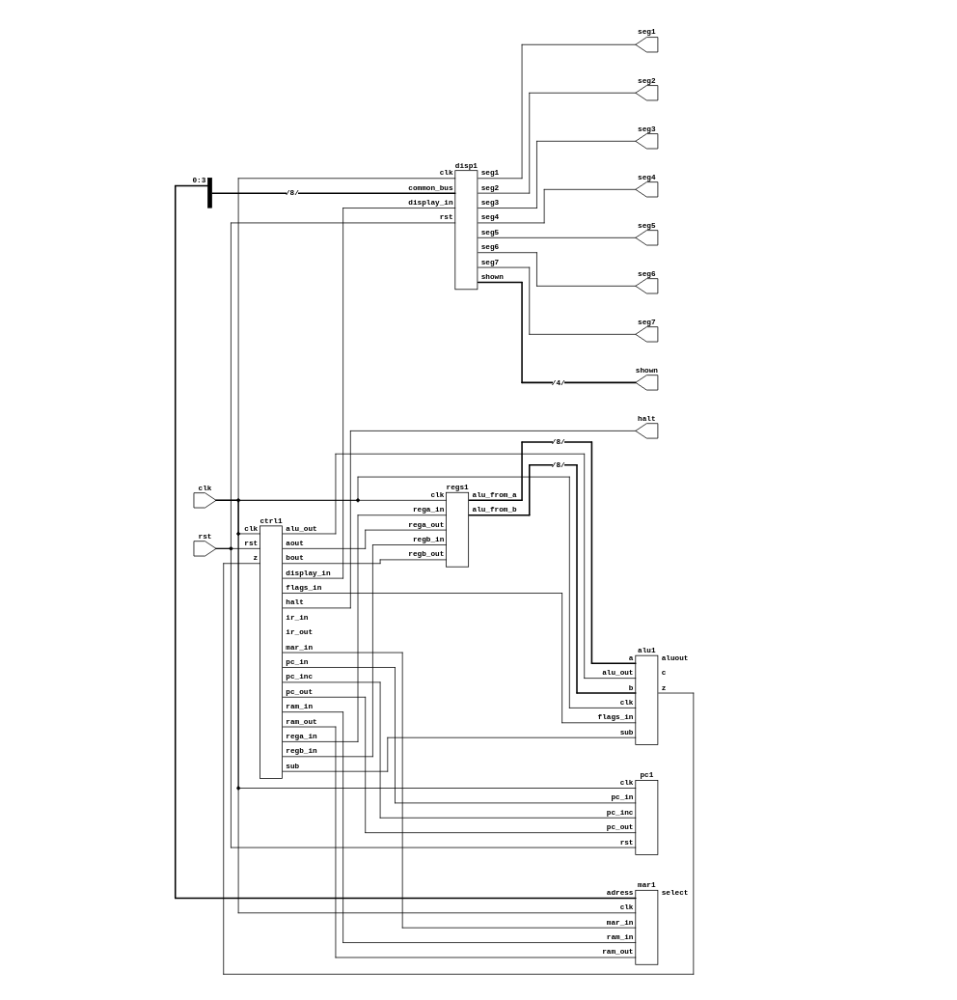

# SAP: Simple-As-Possible Computer in SystemVerilog

A tiny 8-bit computer written in synthesizable Verilog/SystemVerilog. It has a program counter, memory, two registers, an ALU, an instruction register, a control unit and a hex display, all connected by one shared bus. It is built to be read and understood, not to be fast or powerful.

The design follows the SAP ("Simple-As-Possible") computer architecture, which is a teaching architecture for learning how a CPU works from the inside.

## Features

- 8-bit data bus, 4-bit addresses, 16 bytes of RAM (program and data share the same memory)
- 9 instructions, including a jump (JMP) and a conditional branch (BEQ)
- Zero and carry flags
- Hex digit output on a 7-segment display
- Self-checking testbench that runs a loop with a step of 3 (`i += 3`) and prints PASS or FAIL
- Written in plain Verilog-2005 style (`reg`, `wire`, positional port mapping), so it is easy to follow if you are new to HDL

## Architecture

All modules share a single 8-bit common bus. Only one module drives the bus at a time; every other module releases it (high impedance).

```
              +--------------------- common bus (8 bit) ---------------------+
              |        |         |          |         |          |           |
            +----+  +-----+   +-----+    +-----+   +-----+   +-------+   +--------+
            | PC |  | MAR |   | RAM |    |  A  |   |  B  |   |  ALU  |   |   IR   |
            +----+  +-----+   +-----+    +-----+   +-----+   +-------+   +--------+
                                                                |             |
                                                           flags (Z, C)   opcode
                                                                \_____________/
                                                                      |
                                                              +---------------+
                                                              | control unit  |
                                                              +---------------+
```

| Module | File section | Job |
|---|---|---|
| `memory_adress_reg` | MAR + RAM | Holds the address (MAR) and the 16 x 8 bit memory |
| `pc` | Program counter | Holds the address of the next instruction; can count up or load (jump) |
| `registers` | Registers A and B | Two 8-bit registers; A is the accumulator |
| `alu` | ALU | Adds or subtracts A and B; stores the zero and carry flags |
| `display_from_0_to7` | Display | Latches a value and decodes it to a 7-segment hex digit |
| `controls` | Instruction register and control unit | Holds the instruction and generates every control signal |
| `computer` | Top module | Connects all of the above |

## Theory

### The fetch-execute cycle

A CPU repeats the same two phases forever:

1. **Fetch:** read the instruction that the program counter points to, and store it in the instruction register. Then increment the program counter.
2. **Execute:** do what the instruction says.

In this design the control unit is a small step counter. Each clock cycle is one step. Steps 0 and 1 are always the fetch. The steps after that depend on the opcode.

```
Step 0: PC -> bus -> MAR              (point memory at the next instruction)
Step 1: RAM -> bus -> IR, PC = PC + 1 (load the instruction, move on)
Step 2+: depends on the instruction
```

After the last step of an instruction the step counter returns to 0 and the next fetch starts.

### The shared bus

Instead of wiring every register to every other register, they all connect to one bus. A module puts its value on the bus with an "out" signal (for example `pc_out`), and a module reads the bus with an "in" signal (for example `mar_in`). The control unit makes sure only one "out" signal is active at a time. Idle modules drive the bus with `8'bz` (high impedance).

### Control signals

The control unit is combinational logic driven by the current step and the current opcode. It switches signals like `pc_out`, `mar_in`, `ram_out`, `ir_in`, `rega_in`, `alu_out`, `sub`, `flags_in` and so on on or off for each step. Look at the `controls` module to see exactly which signals each instruction uses on each step.

### The ALU and flags

The ALU adds A and B, or subtracts them using two's complement (`A + ~B + 1`). When an ADD or SUB instruction completes, the zero flag (Z) and carry flag (C) are saved. BEQ uses the zero flag. This is how loops that stop at a value are made: subtract the limit, and if the result is zero, branch out.

## Instruction set

Every instruction is 8 bits: the top 4 bits are the opcode and the bottom 4 bits are the operand (an address or an immediate value).

```
 7 6 5 4 | 3 2 1 0
 opcode  | operand
```

**9 instructions are implemented.**

| Opcode | Mnemonic | Operation | Clock cycles |
|---|---|---|---|
| 0x0 | `LDA a` | A = RAM[a] | 4 |
| 0x1 | `ADD a` | A = A + RAM[a], set flags | 5 |
| 0x2 | `SUB a` | A = A - RAM[a], set flags | 5 |
| 0x3 | `STA a` | RAM[a] = A | 4 |
| 0x4 | `LDI n` | A = n (4-bit immediate) | 3 |
| 0x5 | `JMP a` | PC = a | 3 |
| 0x6 | `BEQ a` | if Z flag is 1 then PC = a | 3 |
| 0x7 | `OUT` | display = A | 3 |
| 0xF | `HLT` | stop the computer | - |

Opcodes 0x8 to 0xE are unused; the control unit skips them.

## Example program

The program in RAM counts up in steps of 3 (0, 3, 6, 9, 12), shows each value on the display, and stops when the counter reaches 15.

| Address | Hex | Assembly | Comment |
|---|---|---|---|
| 0 | 40 | `LDI 0` | A = 0 |
| 1 | 3D | `STA 13` | i = 0 |
| 2 | 0D | `LDA 13` | loop start: A = i |
| 3 | 70 | `OUT` | show i |
| 4 | 1E | `ADD 14` | A = i + 3 |
| 5 | 3D | `STA 13` | i = i + 3 |
| 6 | 2F | `SUB 15` | A = i - 15, sets zero flag |
| 7 | 69 | `BEQ 9` | if i == 15 go to 9 |
| 8 | 52 | `JMP 2` | otherwise repeat |
| 9 | F0 | `HLT` | stop |

Data: `RAM[13]` is the variable `i` (starts at 0), `RAM[14]` is the step (3), `RAM[15]` is the limit (15).

To run your own program, edit the `ram[...]` lines in the `initial` block of `memory_adress_reg`. Write the opcode in the top hex digit and the address or value in the bottom hex digit, for example `8'h1E` means `ADD 14`.

## Simulation

Files:

- `design.sv`: all the modules (including the top module `computer`)
- `testbench.sv`: the self-checking testbench (module `tb`)

### EDA Playground

1. Put the contents of `design.sv` in the design pane and `testbench.sv` in the testbench pane.
2. Choose Icarus Verilog as the simulator.
3. Run. A passing run prints:

```
CPU displayed: 0 (expected 0)
CPU displayed: 3 (expected 3)
CPU displayed: 6 (expected 6)
CPU displayed: 9 (expected 9)
CPU displayed: 12 (expected 12)
*** PASS ***
```

### Command line

```
iverilog -g2012 -Wall -o sim design.sv testbench.sv
vvp sim
```

The testbench also writes `dump.vcd`, which you can open in GTKWave or EPWave. Good signals to look at are `common_bus`, `ctrl1.step` and `ctrl1.ir`.

### Important note about port mapping

Modules are connected by position, for example `alu alu1(a, b, alu_out, sub, flags_in, clk, common_bus, aluout, z, c);`. This means the order of the signals in each instance must match the order of the ports in the module definition exactly. If you swap two signals the code still compiles but the computer will misbehave. The expected port order is written as a comment above every module and every instance.

## Synthesis

The design passes RTL synthesis. The RTL schematic is shown below.



Notes:

- RTL-level synthesis completes and produces the schematic above.
- Gate-level synthesis (mapping to a standard-cell liberty library through ABC) currently gives errors in the online tool flow I used. The failure happens inside the ABC mapping step, not in parsing or elaboration of the design. The default Yosys `synth` flow runs without errors. This has not been investigated further, so treat gate-level results as unverified.
- Yosys warns about limited tri-state support. The shared bus is built with high-impedance drivers (`8'bz`), which works in simulation but is not how an FPGA implements an internal bus (FPGAs have no internal tri-state buses). Replacing the bus with a multiplexer controlled by the "out" signals would make it friendlier to FPGA flows.

## Limitations

This is a Simple-As-Possible computer, so many things that a normal CPU has are intentionally missing:

- **No link register and no stack, so no function calls or recursion.** There is no instruction that saves a return address, and no stack pointer. JMP and BEQ only load a fixed address into the program counter, so the CPU cannot call a routine and come back to where it was. Recursion is therefore impossible. Loops and simple branching work.
- Only 16 bytes of memory, shared between the program and its data.
- 4-bit immediate values (0 to 15) for `LDI`; larger constants must be stored in RAM.
- No indirect addressing, so arrays and pointers are not supported.
- Only BEQ for branching (no branch on carry or on not-equal). The carry flag is computed and stored but no instruction reads it yet.
- Unsigned 8-bit arithmetic, and no multiply, divide, shift or logic instructions.
- No interrupts and no input; the only output is the display.

## Possible extensions

- More branch instructions (BNE, BCS) using the existing flags
- A bigger address space, or separate instruction and data memory
- A stack pointer plus CALL and RET instructions (this is what would make recursion possible)
- AND, OR, XOR and shift instructions in the ALU
- Replace the tri-state bus with a multiplexer for FPGA use

## References

- Albert Paul Malvino and Jerald A. Brown, *Digital Computer Electronics*, 3rd edition, McGraw-Hill. The original source of the SAP architecture.
- Ben Eater, "Build an 8-bit computer from scratch" (video series and kit based on the SAP design): https://eater.net/8bit
- David Harris and Sarah Harris, *Digital Design and Computer Architecture*. A good next step for learning how real processors extend these ideas.

## License

Add your preferred license here (for example MIT).
